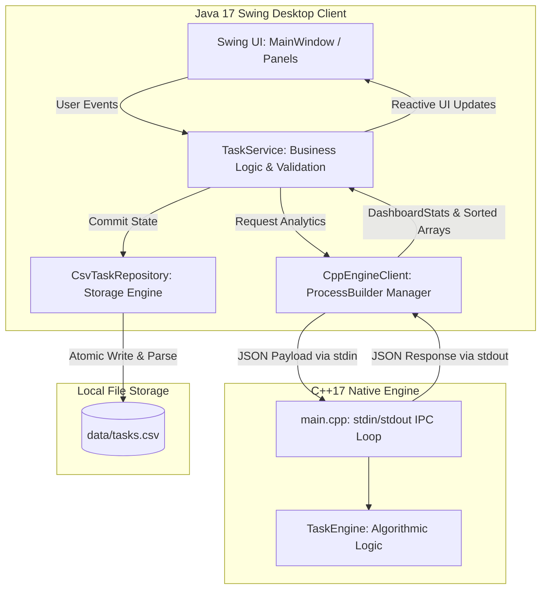
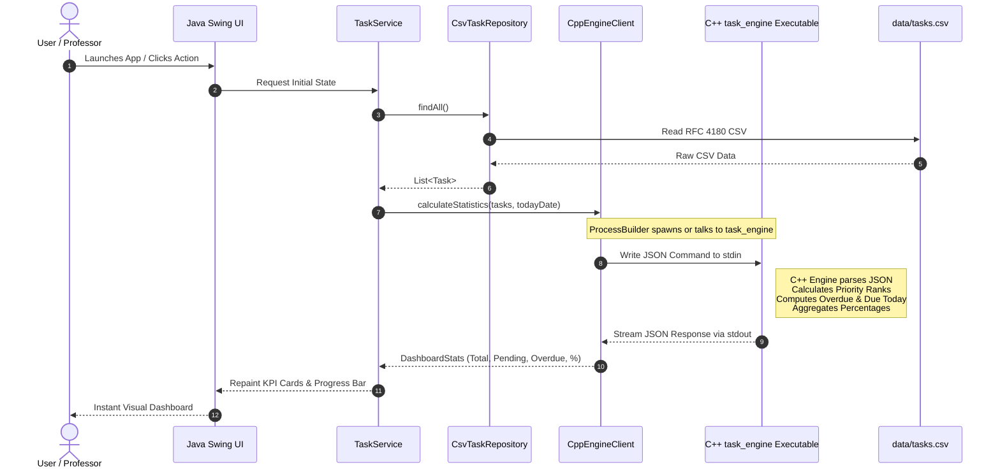

# TASKFLOW SYSTEM ARCHITECTURE & INTER-PROCESS COMMUNICATION SPECIFICATION

This document details the internal architecture, inter-process communication protocol, data persistence mechanisms, and failure handling strategies implemented in **TaskFlow — Smart To-Do Manager**.

---

## 1. HIGH-LEVEL ARCHITECTURE OVERVIEW

TaskFlow splits responsibilities cleanly between two distinct programming languages and runtimes:
- **Java 17 (JVM)**: Acts as the host orchestrator, user interaction layer (Swing), input validation barrier, and persistent storage manager (RFC 4180 CSV).
- **C++17 (Native Binary)**: Acts as the high-speed algorithmic co-processor, responsible for priority ranking calculations, multi-criteria sorting, deadline overdue analysis, and aggregated completion metrics.



---

## 2. SEQUENCE DIAGRAM: LIVE IPC LIFECYCLE

The following sequence illustrates how Java dispatches tasks to the C++ engine when calculating statistics or applying sorting and filtering:



---

## 3. INTER-PROCESS COMMUNICATION (IPC) SPECIFICATION

### 3.1 Transport Protocol
- **Transport Mechanism**: Standard Input (`stdin`) and Standard Output (`stdout`) streams.
- **Process Launcher**: `java.lang.ProcessBuilder`.
- **Encoding**: UTF-8.
- **Framing**: Single-line JSON objects terminated with a standard newline (`\n`).

### 3.2 Command Schemas

#### A. Ping / Health Check
**Request:**
```json
{"action": "PING"}
```
**Response:**
```json
{
  "status": "OK",
  "message": "TaskFlow C++ Engine 1.0 Ready",
  "engine": "C++17 Standalone IPC"
}
```

#### B. Statistics Computation
**Request:**
```json
{
  "action": "STATISTICS",
  "today": "2026-10-14",
  "tasks": [
    {
      "id": "task-1",
      "title": "Complete Data Structures assignment",
      "description": "Implement Red-Black tree deletion",
      "category": "COLLEGE",
      "priority": "HIGH",
      "dueDate": "2026-10-15",
      "completed": false,
      "createdAt": "2026-10-14T09:00:00"
    }
  ]
}
```
**Response:**
```json
{
  "status": "OK",
  "stats": {
    "totalTasks": 1,
    "completedTasks": 0,
    "pendingTasks": 1,
    "overdueTasks": 0,
    "dueTodayTasks": 0,
    "highPriorityPending": 1,
    "completionPercentage": 0.0
  }
}
```

---

## 4. PERSISTENCE & FAULT TOLERANCE

### 4.1 RFC 4180 CSV Storage
TaskFlow stores data in `data/tasks.csv`. Standard CSV parsers frequently break when users type commas or quotes into descriptions. TaskFlow uses an RFC 4180 finite-state machine:
1. Fields containing commas, double quotes (`"`), or newlines are wrapped in enclosing quotes.
2. Internal quotation marks are escaped by doubling them (`""`).
3. Multiline task descriptions are parsed accurately across row boundaries.

### 4.2 Atomic Write Protection
To prevent file corruption if the program is forcibly terminated or power is interrupted:
1. New data is serialized into a temporary file: `data/tasks.csv.tmp`.
2. `Files.move(..., StandardCopyOption.ATOMIC_MOVE, StandardCopyOption.REPLACE_EXISTING)` replaces the target file in a single atomic filesystem operation.

### 4.3 C++ Missing Binary Failover
If the application is launched prior to compiling the C++ engine (e.g. `scripts/run.bat` executed before `scripts/build.bat`), `CppEngineClient` detects the missing binary:
- An informational notice is printed to console.
- Transparent Java fallback routines handle calculation without crashing.
- The UI diagnostics tab displays an amber status advising the user to run `build.bat`.
